# ISP CRM — application flowcharts

These diagrams describe the current implementation in `ispcrm.py` and its `crm_*.py` modules. They cover the main application steps, decisions, and business rules, rather than every individual SQL statement. Open this file in a Markdown viewer with Mermaid support to render the charts.

## 1. Whole application

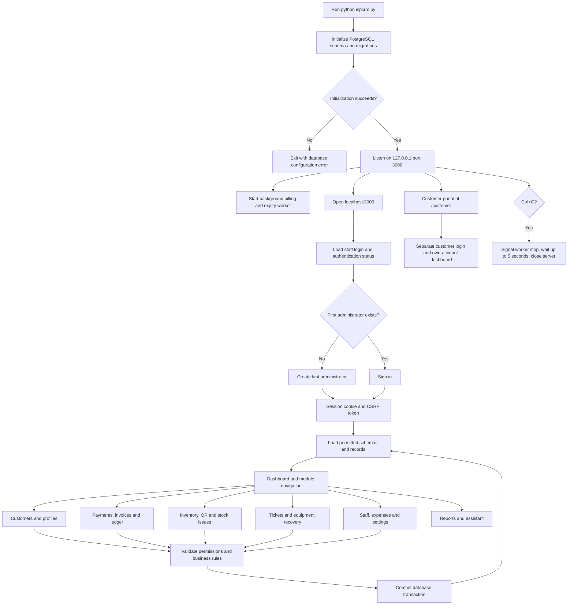

## 2. HTTP routing and access checks

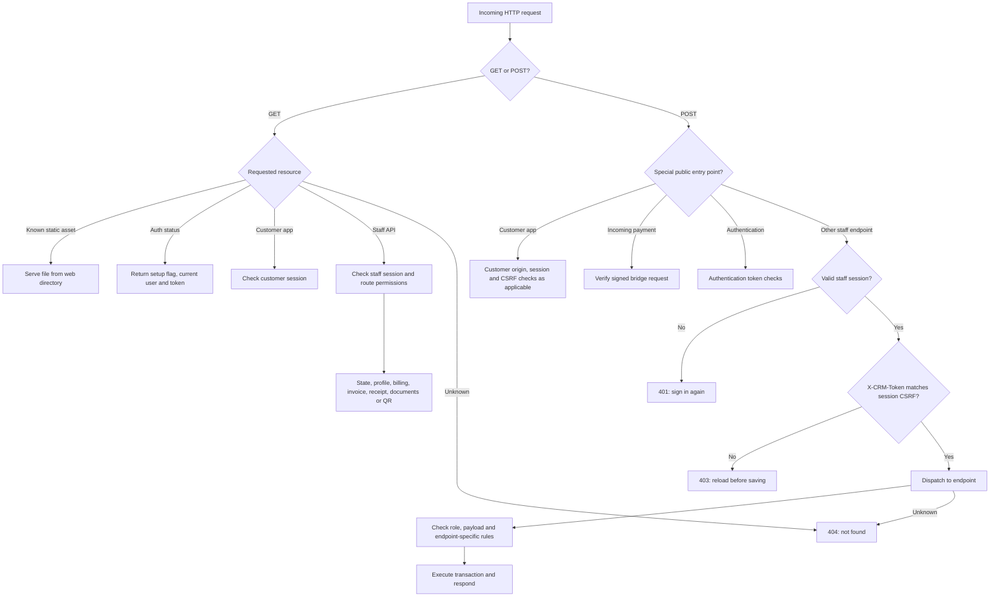

Staff POST endpoints: `/api/record`, `/api/users`, `/api/invoices`, `/api/customer-documents`, `/api/customers/terminate`, `/api/inventory-qr`, `/api/customer-services`, `/api/customer-portal/access`, `/api/customer-portal/notify`, and `/api/assistant`.

## 3. Staff authentication and account administration

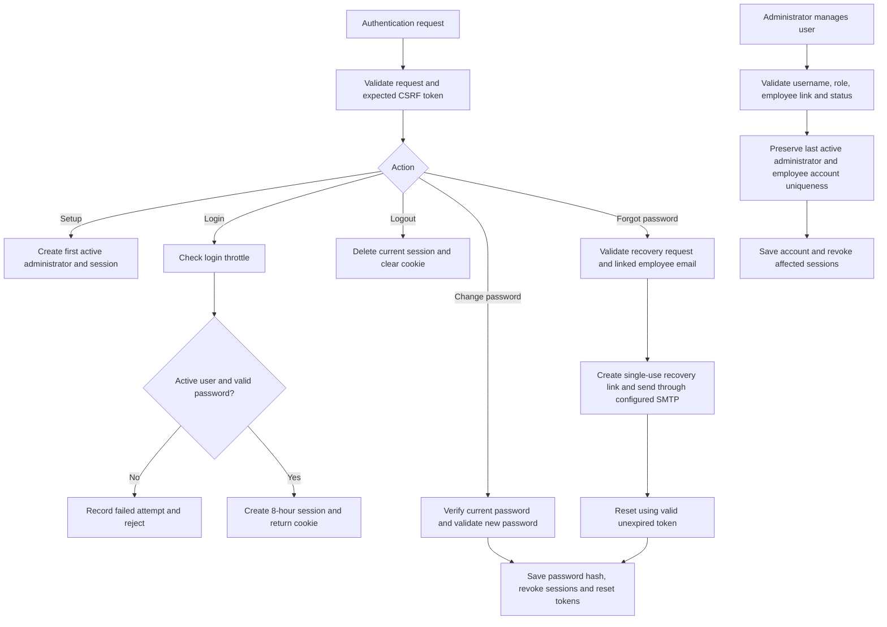

Roles are enforced on the server: Administrator, Manager, Accountant, Support, Technician, Storekeeper, and Viewer. Technician writes are assignment scoped. Staff designation and reporting hierarchy do not independently grant application access. User accounts are deactivated rather than deleted.

## 4. Loading the dashboard and customer profile

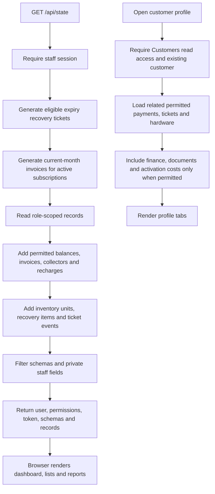

## 5. Common create, update, delete and return logic

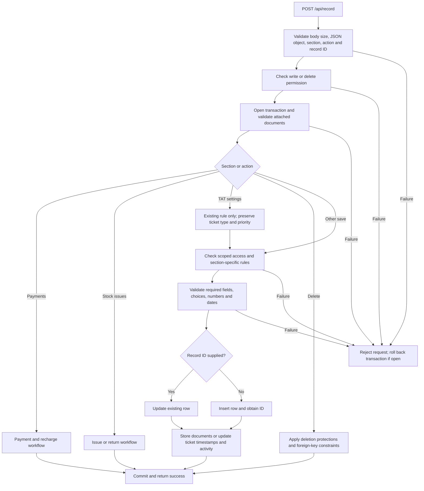

Tickets cannot be deleted. Used packages cannot be deleted or renamed; used designations cannot be deleted. Stock issues cannot be edited or deleted. Saved payment receipts protect their source payments from editing/deletion. Database constraints protect linked records.

## 6. Customer creation and editing

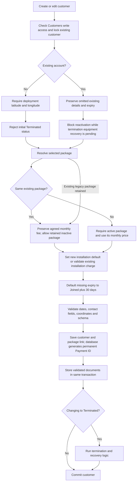

Expiry cannot precede Joined. Coordinates must be paired and within geographic bounds; an existing saved pin cannot be cleared through the editor. Installation charge cannot be reduced below installation payments already received.

## 7. Monthly invoices and account balances

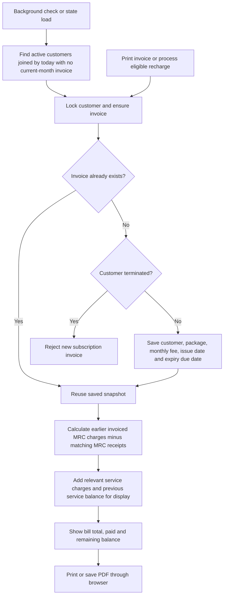

One subscription invoice exists per customer/month. Earlier uninvoiced months are not invented as arrears. Carry-forward debt is not counted again as new subscription sales. Saved snapshots are preserved while balance displays use current payments.

## 8. Payments, receipts and recharge decisions

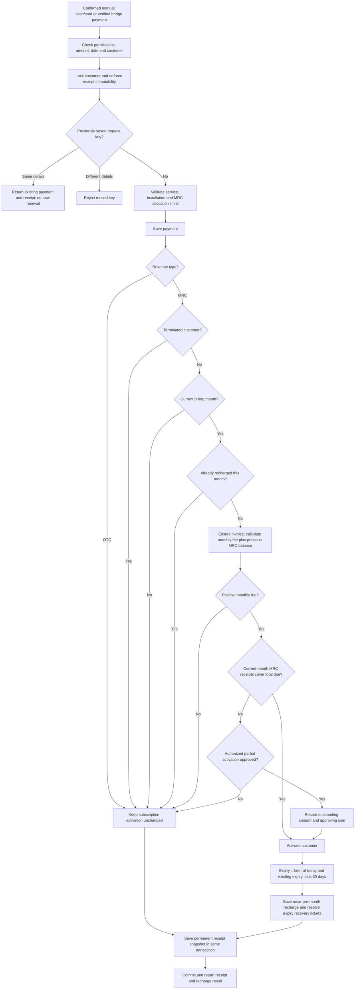

OTC needs a reference and cannot use partial activation. Administrator, Manager, and Accountant may approve partial activation; the bridge cannot. A terminated account may receive payments but is not automatically reactivated. Stock returns do not automatically refund charges.

## 9. Signed incoming payment bridge

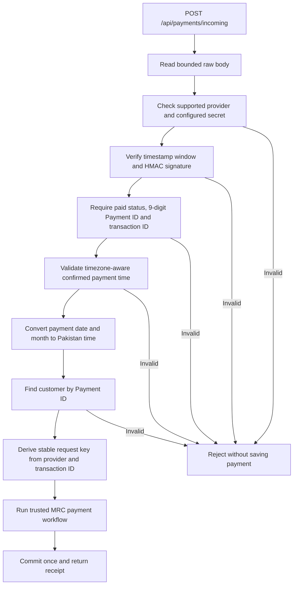

This is an internal signed bridge contract. Native 1LINK, Easypaisa and JazzCash merchant integrations require separate configuration/onboarding.

## 10. Inventory issue and return

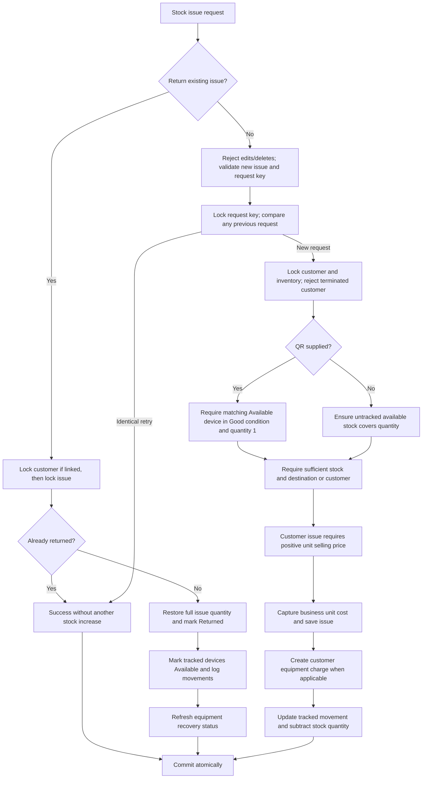

System/network issues do not bill customers. Returns cover the entire saved issue quantity. Request locks and record locks prevent retry deductions and concurrent overselling.

## 11. QR registration, condition and stocktake

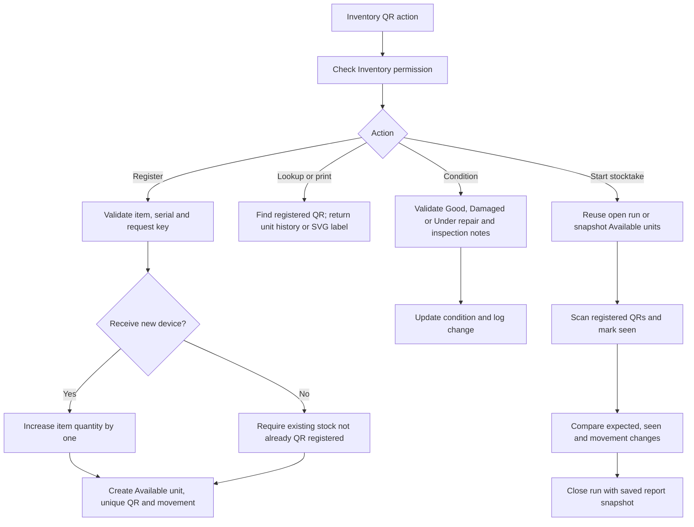

Stocktake reports differences without automatically adjusting inventory quantities. Damaged and under-repair devices cannot be issued.

## 12. Tickets and turnaround targets

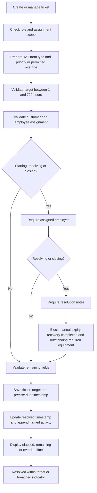

The TAT clock runs continuously. Reopening preserves the original clock. New assignments cannot use staff on leave. Jobs are archived legacy data consolidated into Tickets; the current interface excludes the Jobs schema.

## 13. Termination and automatic expiry recovery

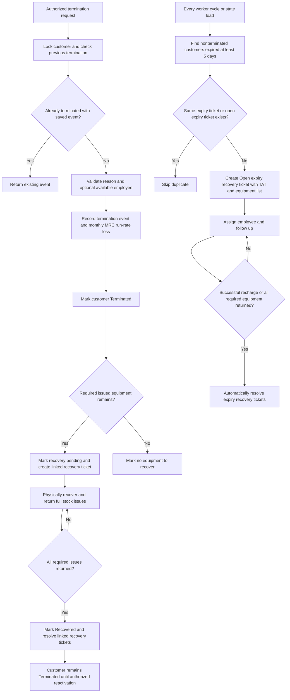

Termination itself never restores stock. Expiry recovery tickets can be generated even when no recoverable equipment is recorded. Automatic expiry checks do not implement router suspension.

## 14. Customer portal

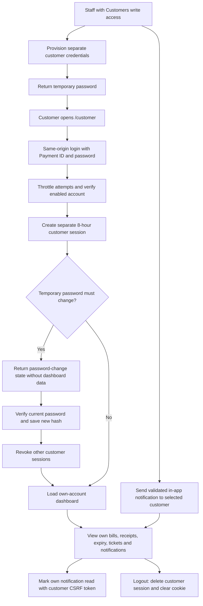

## 15. Documents, extra charges, expenses and administration

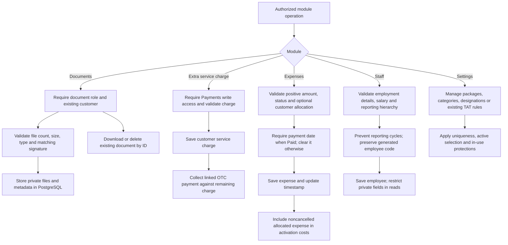

Documents accept PDF, JPEG, PNG and WebP: up to 5 files, 5 MB each and 20 MB combined per upload. Activation costs combine net issued inventory at captured business cost with allocated noncancelled expenses; monthly package costs are separate.

## 16. Assistant, reports and background processing

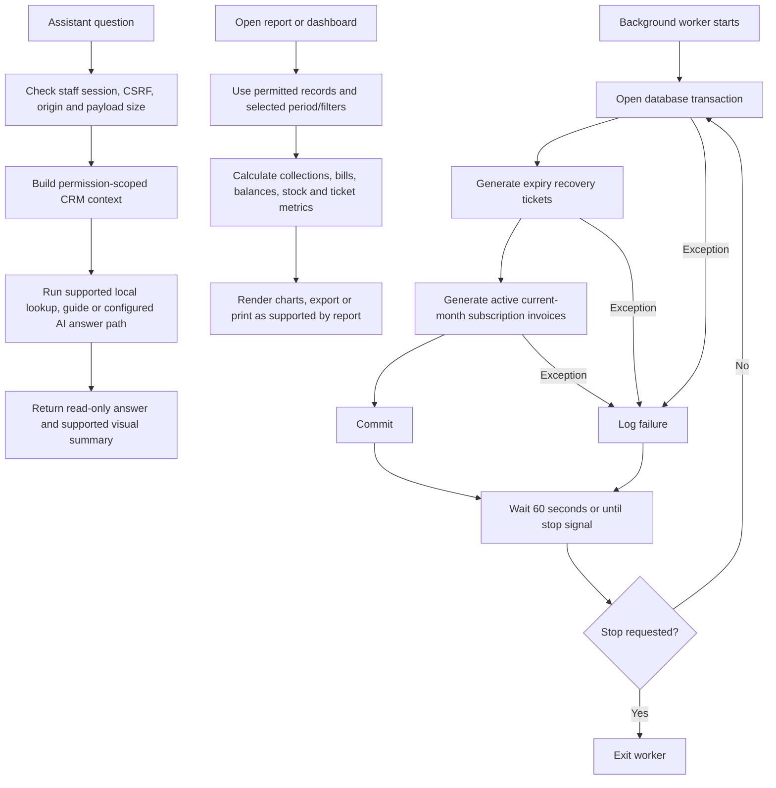

Financial reports distinguish invoice sales, receipt collections and paid expenses. Net cash is collections minus paid expenses. Dates and billing decisions use Asia/Karachi. CRM activation updates database state; live router/RADIUS provisioning is separate.

## 17. Common failure outcomes

| Condition | Usual response |
| --- | --- |
| Invalid input or protected business operation | 400 with explanatory message |
| Missing or expired session | 401 |
| Role, origin, signature or CSRF check fails | 403 |
| Unknown route or missing resource | 404 where explicitly handled |
| Database unavailable | Usually 503; generic record database failures return 500 |
| Database transaction fails | Roll back transactional changes |
| Background processing fails | Log error and retry after the next wait |

## Source map

| Workflow | Implementation |
| --- | --- |
| Startup, routing, records, profile and validation | `ispcrm.py` |
| Database schema and migrations | `crm_data.py` and migration modules |
| Roles, sessions and user management | `crm_auth.py` |
| Password recovery | `crm_password_recovery.py` |
| Monthly invoices and arrears | `crm_billing.py` |
| Confirmed payments and recharge | `crm_recharge.py`, `crm_receipts.py` |
| Signed payment bridge | `crm_gateway.py` |
| Services, hardware charges and ledger | `crm_customer_ledger.py` |
| Device tracking and stocktake | `crm_inventory_qr.py` |
| Ticket targets | `crm_tat.py` |
| Termination and expiry recovery | `crm_termination.py` |
| Customer access and notifications | `crm_customer_portal.py` |
| Private documents and activation costs | `crm_documents.py`, `crm_costs.py` |
| Employee reporting and generated codes | `crm_employee_hierarchy.py`, `crm_employee_codes.py` |
| Assistant answers and visuals | `crm_assistant*.py` |
| Dashboard, reports and forms | `web/` |
