# ISP CRM — Comprehensive English Software Manual

Features · Processes · Master Flowchart · Staff Roles

## 1. About this manual

English reference manual for the browser-based ISP CRM launched by ispcrm.py. Prepared from the local implementation on 21 October 2026. It covers available features, operating rules, implemented process branches, staff permissions and the separate customer portal.

The master diagram connects the whole system. The process atlas expands its branches. Permission tables are generated from the current server role definitions; endpoint-specific exceptions and business restrictions are explained separately.

Scope: the active web application and its supporting crm_*.py and web/ modules. The older desktop_crm.py SQLite/Tkinter application is a separate legacy interface and is not the portal described here. Jobs records are retained as migration history; Tickets is the current work module.

The manual describes implemented scenarios and known rejection/retry paths. External services, configuration values and live account permissions can affect availability. Training screenshots contain fictional records. No live customer data or database credentials are included.

- Start the CRM using start_crm.cmd or python ispcrm.py. Keep its process running. Open http://localhost:3000 on the same computer.
- Customer self-service opens at /customer/. Another device needs an administrator-configured address; localhost refers to that device itself.
- Money: PKR; business timezone: Asia/Karachi; date: YYYY-MM-DD; billing month: YYYY-MM.
- Use the contents to find a feature, then use the matching process chart. Diamonds are decisions; arrows show the next action; blocked paths return an explanatory error.

## 2. Master flowchart — all connected workflows

Read the main entry points at the top, follow the customer/profile branches for everyday operations, and use the finance, equipment, work, portal and worker paths for their outcomes. Cross-links show dependencies rather than a required sequence for every user.

The common guard applies before mutations, even where it is drawn below the operational nodes for readability. Background jobs and signed payment callbacks use their own execution/authentication paths. Reports and assistant answers do not commit business mutations. See the process atlas for detailed validations and rejection paths.


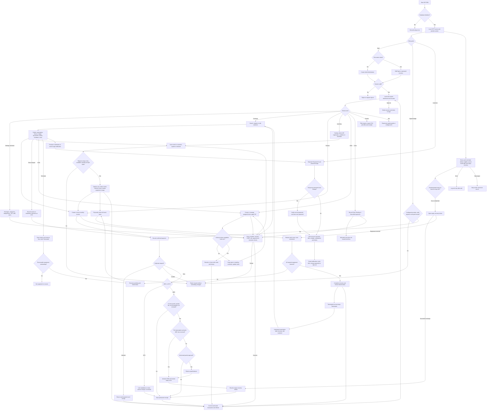


## 3. Feature reference — navigation and dashboard

- Role-specific home: Administrator and Manager receive the company dashboard; other staff receive a role home and permitted financial/operational summaries.
- Overview cards: total/active/new customers, monthly billing receivables and pending bills, daily/monthly collections, billed balances, upcoming expiry, MRC/OTC splits, open work, low stock, terminations and pending equipment recovery.
- Financial analysis: independent daily and monthly period selectors; bills raised, OTC paid sales, MRC/OTC collections, expenses, net cash, customer joins and recharge/activation metrics. Daily graphs and method breakdowns support review.
- Operational charts summarize customer statuses, packages, workload, stock and recent receipts. Read each selected period before comparing totals.
- Customize Dashboard hides/shows cards and can restore Show all. Visibility is stored for the login in that browser; it does not change another user’s permissions.
- Layout: Studio/Standard; themes: Light, Dark, Auto, Ember and Obsidian. Preferences are browser settings. Responsive navigation provides a menu button on smaller screens.
- Module lists support search, permitted create/edit/view actions and CSV export where offered. Dropdown searches filter choices without changing the selection until a choice is made.
- Sign out deletes the current staff session. Password changes require the current password, revoke staff sessions and return the user to sign-in.

## 4. Feature reference — customer records and profiles

- Create/edit residential, business or corporate accounts with name, username, phone, address, email and optional identity/contact fields: CNIC, telephone, passport and NTN.
- Select an active package; the agreed monthly selling fee and installation charge are stored on the customer. Retaining the same package preserves the agreed monthly fee. Package price edits do not automatically reprice existing customers.
- Statuses: Active, Suspended, Disconnected and Terminated. A new account cannot be created directly as Terminated. Termination uses the audited termination workflow.
- Joined/creation date, expiry and optional payment promise date. Missing expiry defaults to Joined plus 30 calendar days. Expiry cannot precede Joined; manually chosen expiry is retained.
- Deployment latitude and longitude are required on new connections, paired and geographically validated, with seven decimal places. Existing saved pins cannot be cleared through the editor. Use current location is an explicit browser action intended at the installation site.
- Permanent generated nine-digit Payment ID: searchable, exportable and included on invoices/receipts. It cannot be edited and is not itself an activated provider biller number.
- Customer list: search and advanced filters for ID/username, name, mobile, email, CNIC, type and status. Clear filters restores the broader list.
- Profile tabs, as permitted: Subscriptions, Documents, Finance, Ledger, Payment history, Activation costs, Tickets, Hardware details and Activity. Top actions include edit, log ticket, print invoice, portal access, notification, refresh, issue stock, terminate and recharge.
- Deletion is constrained by permissions and linked database records. Preserve financial, document, work and equipment history; use the supported lifecycle rather than assuming all customers can be deleted.

## 5. Feature reference — private documents and deployment

- Documents may be attached during customer creation/editing or managed later in the profile. Initial customer changes and attachments are saved atomically.
- Types include identity front/back, application form, installation photo, agreement and other. Accepted files: PDF, JPG/JPEG, PNG and WebP with matching file signatures.
- Upload limits: five files per upload, five MB per file and twenty MB combined. Invalid size/type/signature rejects the upload.
- Administrator, Manager and Support may list, upload, download and delete customer documents. Direct download requests still require authentication and document access.
- Private file bytes and metadata are stored in PostgreSQL. Database backups therefore include documents. Linked documents can block customer deletion.
- Deployment details show the saved coordinates and View deployment on map. The external map opens after a user clicks it. The installation pin describes the customer site, not staff location tracking.

## 6. Feature reference — invoices and subscription debt

- Automatic monthly billing creates one current-month subscription invoice for each eligible Active customer joined by today who lacks that invoice. The periodic worker and staff state refresh trigger the check.
- Authorized users may explicitly issue/reuse a bill for a selected customer/month. Existing snapshots are reused. New subscription invoices cannot be created for Terminated customers.
- The initial subscription snapshot preserves customer identity, package, monthly fee, issue date and expiry-based due date. It uses the full monthly subscription fee, without proration.
- Monthly Invoices supports month, status and text filters, with monthly charge, stock/services, prior balance, total, received, remaining and Open / print.
- Previous MRC balance is earlier saved invoice charges minus MRC receipts matched to those billed months, floored at zero. Uninvoiced historical months are not invented as debt.
- Service charges are displayed in their service month; earlier unpaid service amounts are carried into the presented bill. Carry-forward is not added again as a new monthly sales charge.
- Printing uses the browser Print / Save PDF function. Printing a bill does not confirm a payment, renew expiry or activate a router. Existing invoice snapshots have no supported amend/void workflow.
- Support has an explicit endpoint exception to issue/view customer invoices, despite having no Payments module access. The finance list and customer finance tabs follow their own permissions.

## 7. Feature reference — payments and permanent receipts

- Record confirmed money through Payments or Recharge customer. Payment lookup supports the nine-digit Payment ID. Check customer identity, revenue type, billing month, date, method, amount and reference.
- MRC is monthly subscription revenue. OTC is a one-time Installation, Equipment, Service or Other collection. OTC requires a description in Reference and does not settle subscription MRC or renew an account.
- Only positive amounts and nonfuture payment dates are accepted. The form presents locally recordable methods; provider-named 1LINK/Easypaisa/JazzCash receipts must arrive through the verified bridge.
- Before save, payment/customer/service/installation validations and row locks protect balances. Installation collections cannot exceed the agreed remaining installation charge. Linked service collections cannot exceed their remaining charge.
- Request keys protect retries: identical details reuse the saved payment/receipt; conflicting details with the same key are rejected. Do not intentionally use a new request for money already recorded.
- A permanent receipt snapshot is saved in the same transaction as the payment and any renewal. It includes customer identity, Payment ID, receipt and payment IDs, amount, method, reference, dates, recorder, account/expiry and activation outcome.
- Open Receipt / Print from Payments or an RCP link in the profile. Later customer edits do not alter saved receipts. Saved receipt payments, completed recharge payments and online receipts are protected from edits/deletion.
- Some historical payments receive labelled historical receipt snapshots during migration. Historical payments are not replayed automatically to create new renewals.

## 8. Feature reference — full and partial recharge

- Automatic renewal applies only to current-billing-month MRC on an eligible nonterminated customer, with a positive subscription fee and no existing recharge for that customer/month.
- Current-month receipts accumulate against the invoice subscription charge plus previous unpaid invoiced MRC balance. Full payment activates the CRM account.
- New expiry = max(today, current saved expiry) + 30 days. A billing month renews once; later receipts may settle debt but do not add another extension for that month.
- Partial default: save receipt and leave account activation unchanged until paid in full. Administrator, Manager and Accountant may explicitly choose partial activation and carry the unpaid amount forward.
- Partial approval records the approving user, unpaid amount and previous/new expiry; the receipt preserves the decision. The bridge cannot approve partial activation. OTC cannot request activation.
- Example with no other charges: a PKR 2,000 bill and PKR 800 receipt leave PKR 1,200 unpaid. Approved partial activation renews once; the next PKR 2,000 subscription bill shows PKR 3,200 including the prior debt.
- Past/future-month payments, a zero fee, an already-recharged month or a Terminated account save permitted receipts without a new renewal. A successful recharge resolves open expiry-recovery tickets.
- These actions update CRM records. Router/RADIUS provisioning is not connected by saving a payment.

## 9. Feature reference — services, installation and ledger

- Finance → Add service charge records a positive dated customer charge with description and recorder. Retry keys prevent duplicate service creation.
- Use Record payment on the relevant service row to link an OTC payment to that charge. Customer, service month, OTC category and amount must match the charge.
- Customer stock issues automatically create an Equipment service charge at quantity × captured unit selling price in the issue month and ensure the applicable subscription invoice.
- Installation charge is an agreed one-time customer charge separate from monthly subscriptions. The profile shows charge, paid and due, with Record installation payment when applicable.
- The ledger debits each saved subscription invoice, extra service and agreed installation once, and credits all payments. A stand-alone unlinked noninstallation OTC cash sale includes its matching debit so the sale and collection do not distort debt.
- Rows are date ordered and include reference, description, debit, credit and running balance. Positive means the customer owes money; negative means credit. It is distinct from a subset report of only MRC bills.
- Collect extra services separately from MRC. If unpaid services exist, an MRC receipt exceeding subscription due is rejected rather than silently allocating money to the wrong service.
- Physical stock returns do not automatically cancel a charge or create a refund. The current application does not provide a general credit-note/refund workflow.

## 10. Feature reference — inventory catalog and stock movements

- Inventory stores item, active category, quantity, minimum stock, business unit cost, customer selling price and location. Low-stock views use the minimum stock threshold.
- Category selection must exist and be active for new assignments. Existing inactive categories may be retained. A stale original quantity can cause a reload-required rejection to protect concurrent changes.
- Issue stock against Customer, System or Network; record responsible employee, date, quantity, destination where relevant and recovery-required choice. Customer issues require a customer and positive selling price.
- A new issue locks the request key and relevant rows, checks available stock and captures unit cost. Customer stock is billed; System/Network stock is not billed to a customer.
- Stock issue creation and deduction are atomic. Insufficient stock and issuing to Terminated customers are rejected. Identical retries do not deduct twice; conflicting request reuse is rejected.
- QR-labelled units must be issued individually using their QR. Unlabelled stock cannot consume quantities reserved for available registered devices.
- Return stock restores the full saved issue quantity once, marks Returned and updates movements/recovery. Physically receive all units before confirming. Partial return of one issue is not supported.
- Issue records cannot be edited/deleted. For a correction, return the original issue and make a corrected issue. Historical issue cost remains unchanged when inventory prices later change.

## 11. Feature reference — device QR, inspection and stocktake

- Register / Receive QR device records one physical unit, optional serial/MAC and a unique QR. Existing stock registration leaves quantity unchanged; receive-new adds one to stock.
- Registration checks the item, serial uniqueness and request key. Existing-stock registration requires an unlabelled available unit; identical registration retries return the original unit.
- QR device register lists devices. Lookup/history shows identity, current state/condition and movements. QR labels can be printed as SVG-backed labels.
- Device states: Available or Issued. Conditions: Good, Damaged, Under repair. Issue requires Available and Good, matching inventory item and quantity one.
- Condition changes require inspection notes and create history. A return marks the tracked unit Available; condition still governs whether it may be issued again.
- QR stocktake reuses an open run or snapshots expected Available units and movement baselines. Scans mark seen; duplicates do not count as multiple devices.
- The report compares expected, seen and movement-change flags, including devices scanned that were not in the expected set. Closing saves a report snapshot.
- Stocktake does not automatically adjust quantities. Inventory Reconciliation separately compares current catalog quantities, tracked in-store/issued units, damaged/repair units, unlabelled quantities and stock value.

## 12. Feature reference — tickets, assignment and TAT

- Ticket types: Network outage, Slow speed, Billing, Installation, Complaint, Maintenance, Collection, Equipment recovery, Equipment and Other.
- Fields include subject, customer, assigned employee, type, priority, status, due date, description, resolution notes and TAT/deadline. Create from Tickets or Log ticket on a customer.
- Statuses: Open, In progress, Awaiting customer, Resolved, Closed. Starting/resolving/closing requires an assignee. Resolving/closing requires resolution notes.
- New assignments cannot select an employee on leave. A technician may change only status, description and resolution notes on assigned tickets; cannot create tickets, reassign or change customer, priority, deadline or TAT.
- Default TAT: Urgent 2 hours, High 4, Normal 24, Low 48; saved type/priority settings override defaults. Permitted targets are whole hours from 1 to 720.
- TAT uses continuous calendar time from original creation, with precise PKT deadlines, elapsed/remaining/overdue indicators and within-target/breached outcomes. Awaiting customer does not pause it; reopening retains the original clock.
- Activity records named changes, assignment, resolution and target edits. Filters cover type, active/all statuses, assignee and priority. Tickets cannot be deleted.
- Recovery-linked tickets enforce physical recovery rules. Expiry recovery tickets are auto-resolved by successful recharge or required stock returns instead of ordinary manual completion. Legacy date-based clients preserve their supported deadline behavior.

## 13. Feature reference — termination and expiry recovery

- Terminate account requires Customers write access, a valid customer, a reason up to 2,000 characters and an optional available recovery employee.
- The transaction saves an auditable termination event, date/time, actor and monthly fee run-rate lost. Customer status becomes Terminated; no physical stock is restored merely by termination.
- Recoverable items are issued customer stock issues marked Recovery required = Yes. If any remain, a recovery-pending event and linked Equipment recovery ticket are created; otherwise no equipment needs recovery.
- Device recovery / Equipment recovery lists events, reason, monthly loss and pending items. Recover and return to stock requires the full physical issue quantity.
- Returning the final required item completes pending recovery and resolves linked work. The customer remains Terminated. Authorized reactivation is a separate customer edit and is blocked while termination recovery remains pending.
- Payments for a Terminated account do not automatically reactivate it. New subscription invoices and new customer stock issues are blocked. Existing bills/receipts remain available under permissions.
- Repeated termination submissions reuse the current termination event. Reactivation followed by a later termination creates another event. Monthly loss is recorded gross MRC run-rate, not a cash refund or prorated loss.
- Nonterminated customers whose expiry is at least five days old receive an expiry-recovery ticket if an open/duplicate one does not already exist. It can be created even with no recoverable equipment. Recharge or completed equipment return resolves it; no automatic router suspension is implemented.

## 14. Feature reference — expenses and activation costs

- Expenses record title, category, payee, positive amount, expense date, status, payment method/date, reference, notes and optional customer allocation.
- Categories: Bandwidth / Upstream, Staff salaries, Office rent, Electricity, Fuel / Transport, Equipment purchase, Fiber / Cable, Repairs / Maintenance, Software / Licenses, Marketing, Other.
- Statuses: Paid, Pending, Cancelled. Paid requires a payment date. When not Paid, the payment date is cleared. Filters cover expense month, status and category.
- Recorded totals use expense date; paid totals use payment date; cancelled expenses are excluded from relevant expense/cost totals.
- Activation costs requires Expenses read permission. Net issued inventory cost uses quantity × captured issue unit cost; returned values are shown separately. Allocated Paid and Pending expenses contribute; Cancelled expenses do not.
- Older issues may carry Historical estimate markers and unpriced warnings. Recurring package monthly cost is shown separately. Selling/installation fees are revenue terms, not installation business cost.
- Avoid recording an issued material’s acquisition cost again as a customer activation expense. Staff salary details are agreements; actual salary payments must be entered as expenses. There is no automatic payroll disbursement process.

## 15. Feature reference — staff, settings and account administration

- Staff: generated employee code, contact/work role, area, availability, designation, department, employment type and joining date; optional identity, emergency contact, salary, allowances/deductions and banking fields.
- Salary validation rejects invalid amounts and deductions above salary plus allowances. Birth date must precede joining date when both are provided. Private employment/salary/identity fields are restricted to Administrator and Manager in staff record responses.
- Reports to builds a reporting tree; self-reporting and circular chains are rejected. A new designation selection must be active. The employee role/designation/hierarchy does not independently grant app permissions.
- Packages & pricing: name, speed, monthly selling price, monthly business cost, installation fee and status. Speed must be positive. Used packages cannot be deleted/renamed; deactivate instead.
- Inventory categories: create, rename, activate/deactivate, delete if unused. Renames update linked inventory. Used categories cannot be deleted. Employee designations similarly support controlled changes; renaming updates staff.
- Ticket TAT settings: edit existing type/priority rules with 1–720 hours; preserve the rule identity. No ordinary add/delete operation for TAT rules. Default changes apply to new tickets; existing tickets have their own target.
- User management: Administrator only. Set name, lowercase unique username, designation, built-in role, Active/Inactive status, optional employee link and password. A Technician must link an employee; one account per linked employee.
- Editing a user revokes that user’s staff sessions/reset tokens. The last Active Administrator cannot be deactivated/demoted. User deletion is unsupported; deactivate instead. Staff registration alone does not create a login.

## 16. Feature reference — staff authentication and password recovery

- First visit without users creates the initial owner Administrator; setup closes after an account exists. There is no built-in default password.
- Username format: 3–80 permitted characters; password length: 10–128. Passwords are salted PBKDF2-SHA256 hashes. Login requires an Active account and valid password; repeated attempts are throttled.
- Staff session cookies are HttpOnly and SameSite; sessions expire after eight hours. Mutation requests use session CSRF tokens. Expired/missing sessions require sign-in again.
- Change Password verifies the current password, saves the new hash, revokes sessions/reset tokens and requires a fresh login. Sign out deletes the current session.
- Forgot password uses the registered email on a linked employee, an active unique matching account, a configured email service, and throttled requests. Generic messages avoid revealing whether an account exists.
- Reset links expire in 20 minutes, are single-use, and must still match the employee email and active account. Reset saves the new password and revokes existing staff sessions.
- If recovery email is unavailable or the login is unlinked, ask the Administrator to manage the account. Configuration is a local administrator task, not a visible customer feature.

## 17. Feature reference — customer self-service portal

- Staff with Customers write access use Customer app access to provision/reset separate customer credentials. A temporary password is generated, old portal sessions revoked, and a password change required.
- Customer login uses nine-digit Payment ID and password, an enabled portal account, independent customer cookie/session, throttling and same-origin checks. Session lifetime is eight hours.
- Before changing the temporary password, dashboard data is withheld. Password change verifies the current password and revokes other customer sessions. Customer CSRF checks protect subsequent writes.
- Overview displays own status, expiry, subscription and due amount. If no current saved subscription invoice exists, the due amount may include the current fee estimate; Terminated accounts do not receive that estimated new fee.
- Bills: list and View / Print including services and arrears. Receipts: confirmed saved payment snapshots. Notifications: read entries and Mark as read. Support: existing customer tickets. Account: password change.
- Staff may Send app notification with a validated title/body. Portal refresh also creates deduplicated in-app updates for bills, receipts, ticket updates, services and near/past expiry.
- This customer portal displays records; it has no customer self-payment checkout or new-ticket submission form. Customers contact their ISP for payment instructions and new support requests.
- Install app may appear when the browser supports installation. Service-worker/manifest support does not by itself connect WhatsApp, background push or router provisioning.

## 18. Feature reference — reports and exports

All financial reports require Payments read access; Inventory Reconciliation requires Inventory read. Set From/To, select a report, search, Export CSV or Print. Read the report note before reconciling. CSV export is a spreadsheet file, not a database backup. Sales, cash collections, debt and profit are distinct measures.


| Report | Purpose and interpretation |
| --- | --- |
| Inventory Reconciliation | Current store vs QR quantities, condition counts, unlabelled stock and stock value. Date filters do not apply. |
| Monthwise Collection | Group receipts by payment month; separate MRC and OTC. |
| Collection Reports | Group receipts by payment date. |
| Promise Date Report | Saved customer promise dates in the chosen range; edit the customer to change the promise. |
| Expiry Report | Saved expiry dates in range, including inactive customers. |
| Staff Collection | Group by receipt recorder/source, not assigned collection employee. |
| Collection Report 1 | Group collections by payment method. |
| Accounts Report | MRC and installation balances as of To date; From is ignored. MRC uses saved bills and matched receipts. |
| Daily Sales Report | Subscription bills raised plus paid OTC; carried debt is not counted again as sales. |
| Transaction Wise Report | Receipt-level transaction details. |
| Recharge Report | Successful CRM activation events by PKT activation date, including partial approvals. |
| Package Wise Report | Group by current package; collections follow dates; active fee totals are current run-rate. |

## 19. Feature reference — assistant, integrations and operations

- CRM assistant: read-only System guide and permission-scoped lookups/summaries, with supported charts/visuals. It cannot save payments, activate accounts, change records or send messages.
- Optional AI mode requires explicitly configured local AI settings/API credentials and model. Only scoped context is assembled; users can choose System guide. Service failure returns an error/fallback instruction.
- Signed incoming receipt bridge: supports named provider contracts for 1LINK, Easypaisa and JazzCash, disabled unless the provider secret is configured. It verifies HMAC, timestamp, paid status, transaction ID, Payment ID and payment time.
- The bridge derives a stable provider/transaction request key and passes a trusted current payment into the shared payment workflow. It is not a provider-native merchant integration or proof that merchant onboarding is complete.
- The background worker checks expiry recovery and monthly invoices, then waits 60 seconds; errors are logged and retried on the next cycle. State refresh also performs the generation checks. Constraints/deduplication avoid duplicate bills/tickets.
- Storage uses PostgreSQL with transactions and parameterized queries. Routine configuration uses local database/email/AI files or supported environment settings. These files are not user-facing records.
- Backups/restores are administrator database operations using PostgreSQL tools, not a built-in portal backup button. Include database-stored documents; preserve local configuration separately.
- Ctrl+C signals worker shutdown, waits briefly and closes the HTTP server. If localhost fails, check the application process, PostgreSQL service, address/port and startup logs.

## 20. Staff role assignment — job-based guide

A staff work Role (Technician, Support, Collector, Manager, Other) and a designation are employee descriptions. The User account Role is the authorization control. There is no separate built-in Collector application role. Use Accountant for a collector who must post receipts, or Viewer for read-only review; approve any broader responsibility deliberately. There is no custom permission editor in this version.


| Application role | Suitable job responsibility | Important boundary |
| --- | --- | --- |
| Administrator | Owner or designated system administrator | Full business access and user administration; still subject to data/financial lifecycle rules. |
| Manager | Operations/branch manager | Business operations, finance, inventory and settings; cannot manage user accounts. |
| Accountant | Accounts/finance officer or authorized cashier | Payments/expenses write; customers/packages read; no customer/package editing. |
| Support | Customer support or registration officer | Customers/tickets write, staff/packages read; explicit invoice exception; no Payments list access. |
| Technician | Field technician linked to employee | Assigned tickets only for allowed updates; stock issues visible only for that employee; no stock issuing. |
| Storekeeper | Warehouse/store officer | Inventory and stock issue/return operations; customer/staff/category read; no payment collection. |
| Viewer | Read-only business observer | Business reads only, excluding user accounts/private staff fields/documents; dedicated invoice-issue endpoint caveat below. |

## 21. Staff role matrix — server module grants

R = read; W = create/update through supported workflows; D = base delete grant. A grant is necessary but does not override endpoint validation, immutability, assignment scope or linked-record protections. This table is generated directly from crm_auth.ROLES.

- Jobs is excluded from active grants. Monthly Invoices, receipts, costs, documents, assistant and customer access are endpoint/profile features rather than separate base schema grants; see the next table.
- Technician Tickets W is update-only on assigned work, limited to status, description and resolution notes. Technician Stock issues R is employee-scoped. Other readable customers/staff/inventory are not assignment-limited by that rule.
- Equipment recovery is an operational generated lifecycle; base W/D grants for broad roles do not imply a supported free-form recovery editor. Use termination and physical return endpoints.

| Module | Administrator | Manager | Accountant | Support | Technician | Storekeeper | Viewer |
| --- | --- | --- | --- | --- | --- | --- | --- |
| Customers | R/W/D | R/W/D | R | R/W | R | R | R |
| Inventory | R/W/D | R/W/D | — | — | R | R/W | R |
| Staff | R/W/D | R/W/D | — | R | R | R | R |
| Tickets | R/W/D | R/W/D | — | R/W | R/W | — | R |
| Payments | R/W/D | R/W/D | R/W | — | — | — | R |
| Expenses | R/W/D | R/W/D | R/W | — | — | — | R |
| Packages | R/W/D | R/W/D | R | R | — | — | R |
| Categories | R/W/D | R/W/D | — | — | — | R | R |
| Equipment recovery | R/W/D | R/W/D | R | R | — | R | R |
| Stock issues | R/W/D | R/W/D | — | — | R | R/W | R |
| Designations | R/W/D | R/W/D | — | — | — | — | R |
| TAT settings | R/W/D | R/W/D | — | — | — | — | R |
| Users | R/W | — | — | — | — | — | — |

## 22. Role exceptions and sensitive features

Read-only caveat: a Viewer is denied the explicit invoice-issue endpoint, but staff GET /api/state runs automatic invoice/recovery generation before returning scoped data. Therefore opening the workspace can trigger scheduled bookkeeping even for a read-only business user. This is current implementation behavior, not a recommendation to grant additional access.


| Feature | Roles / checks actually used |
| --- | --- |
| Private staff fields | Administrator, Manager; other staff readers receive reduced records. |
| Customer documents | Administrator, Manager, Support only. |
| Create/reuse customer invoice | Administrator, Manager, Accountant, Support only. |
| View saved invoice endpoint | Customers + Payments read, or explicit Support exception; Viewer may view saved invoices. |
| Monthly invoice list / financial tabs / receipts | Payments read: Administrator, Manager, Accountant, Viewer. |
| Post payments / service charges | Payments write: Administrator, Manager, Accountant. |
| Approve partial activation | Administrator, Manager, Accountant; not trusted gateway. |
| Activation costs | Expenses read: Administrator, Manager, Accountant, Viewer. |
| Terminate / provision customer login / notify | Customers write: Administrator, Manager, Support. |
| Inventory QR registration, condition and stocktake | Inventory write: Administrator, Manager, Storekeeper. Inventory readers may view lookup/registry/report data. |
| Issue/return stock | Stock issues write: Administrator, Manager, Storekeeper. |
| Create/edit user login | Administrator only; retain one active Administrator. |
| Reports | Financial: Payments read. Inventory Reconciliation: Inventory read. |
| Assistant | Signed-in staff; answers/context restricted to the user’s available records. |
| Customer portal | Separate enabled customer account; only that customer’s information. |

## 23. Account provisioning and protected operations

- Administrator workflow: register the employee if needed → Settings → User management → Create user → set role, designation, employee link, Active status and password → save → deliver credentials appropriately.
- Technicians must link an employee. One linked account per employee is enforced. Editing role/status/password revokes the user’s existing sessions. Deactivate rather than delete accounts.
- Changing Reports to or employee designation does not change application role. UI role suggestions based on designation can be overridden by the Administrator.
- D in the matrix is not an unrestricted deletion promise: tickets cannot be deleted; stock issues cannot be edited/deleted; user accounts are not deleted; saved payments and receipt snapshots are immutable.
- Used packages cannot be deleted or renamed; used categories/designations cannot be deleted. Category/designation rename behavior preserves linked records. TAT rules are existing-rule edits only.
- New stock and new subscription bills are blocked for Terminated accounts. Required equipment must be recovered before supported reactivation. Deleting parent records can be blocked by database foreign keys.
- The manual exposes current broad role grants rather than inventing finer-grained approval workflows. If a job requires permissions outside these built-ins, application changes are needed; an employee title alone is not enough.

## 24. Process atlas — Whole application


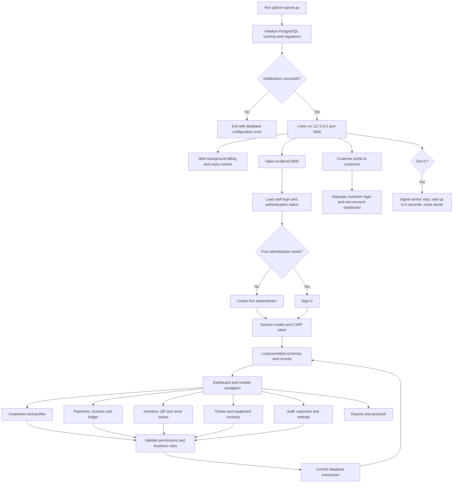


## 25. Process atlas — HTTP routing and access checks

Staff POST endpoints: /api/record, /api/users, /api/invoices, /api/customer-documents, /api/customers/terminate, /api/inventory-qr, /api/customer-services, /api/customer-portal/access, /api/customer-portal/notify, and /api/assistant.


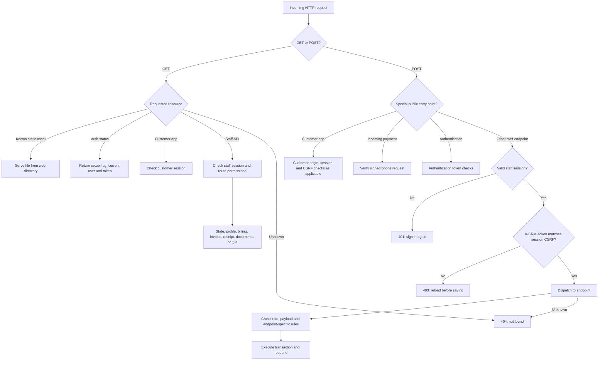


## 26. Process atlas — Staff authentication and account administration

Roles are enforced on the server: Administrator, Manager, Accountant, Support, Technician, Storekeeper, and Viewer. Technician writes are assignment scoped. Staff designation and reporting hierarchy do not independently grant application access. User accounts are deactivated rather than deleted.


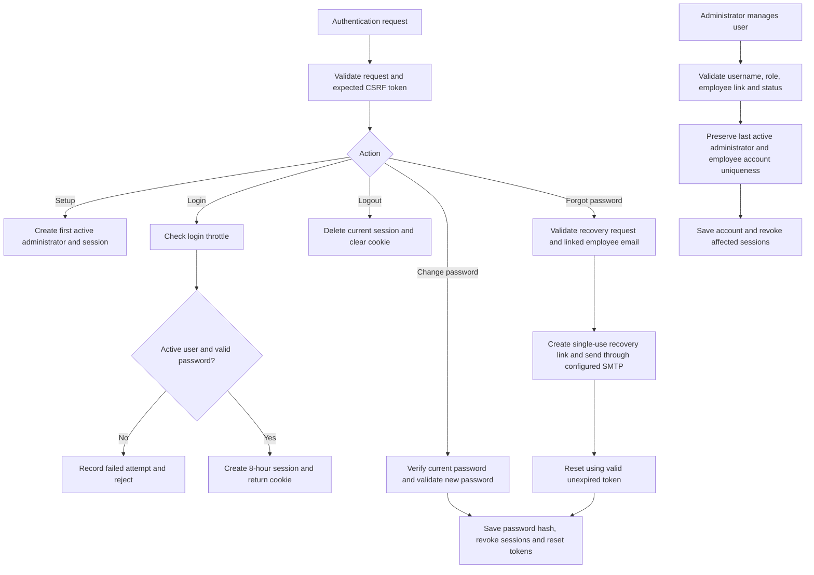


## 27. Process atlas — Loading the dashboard and customer profile


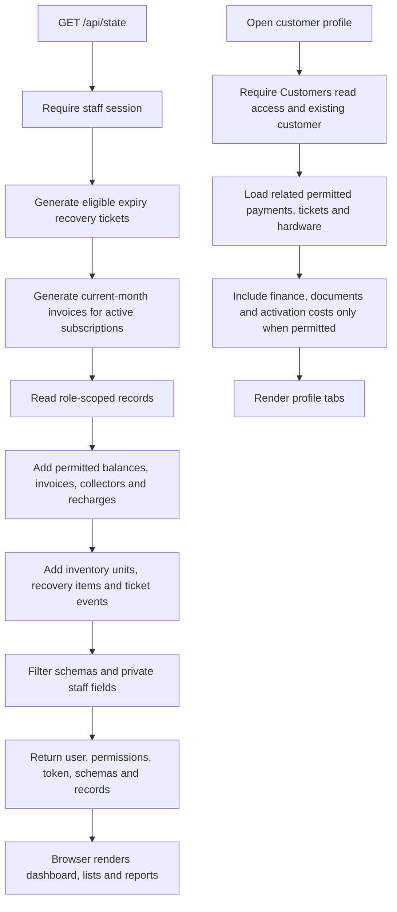


## 28. Process atlas — Common create, update, delete and return logic

Tickets cannot be deleted. Used packages cannot be deleted or renamed; used designations cannot be deleted. Stock issues cannot be edited or deleted. Saved payment receipts protect their source payments from editing/deletion. Database constraints protect linked records.


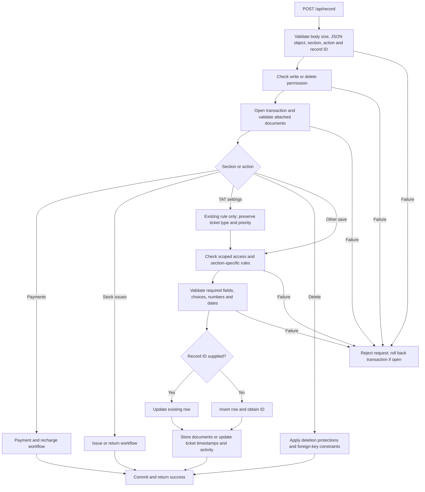


## 29. Process atlas — Customer creation and editing

Expiry cannot precede Joined. Coordinates must be paired and within geographic bounds; an existing saved pin cannot be cleared through the editor. Installation charge cannot be reduced below installation payments already received.


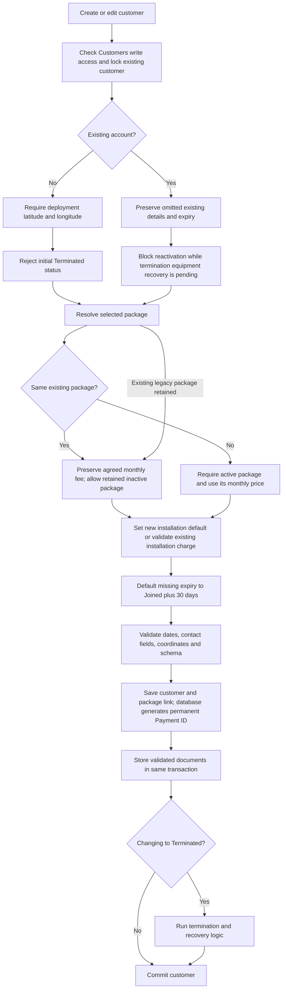


## 30. Process atlas — Monthly invoices and account balances

One subscription invoice exists per customer/month. Earlier uninvoiced months are not invented as arrears. Carry-forward debt is not counted again as new subscription sales. Saved snapshots are preserved while balance displays use current payments.


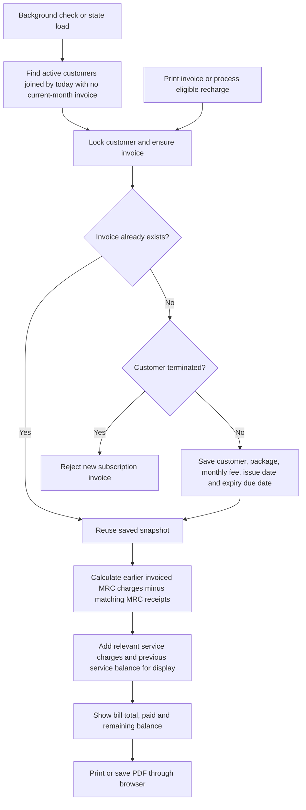


## 31. Process atlas — Payments, receipts and recharge decisions

OTC needs a reference and cannot use partial activation. Administrator, Manager, and Accountant may approve partial activation; the bridge cannot. A terminated account may receive payments but is not automatically reactivated. Stock returns do not automatically refund charges.


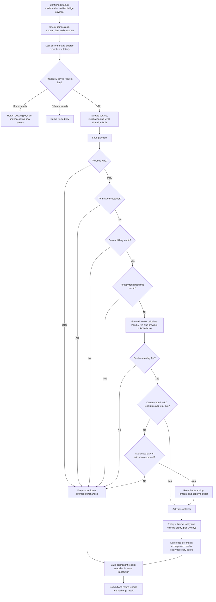


## 32. Process atlas — Signed incoming payment bridge

This is an internal signed bridge contract. Native 1LINK, Easypaisa and JazzCash merchant integrations require separate configuration/onboarding.


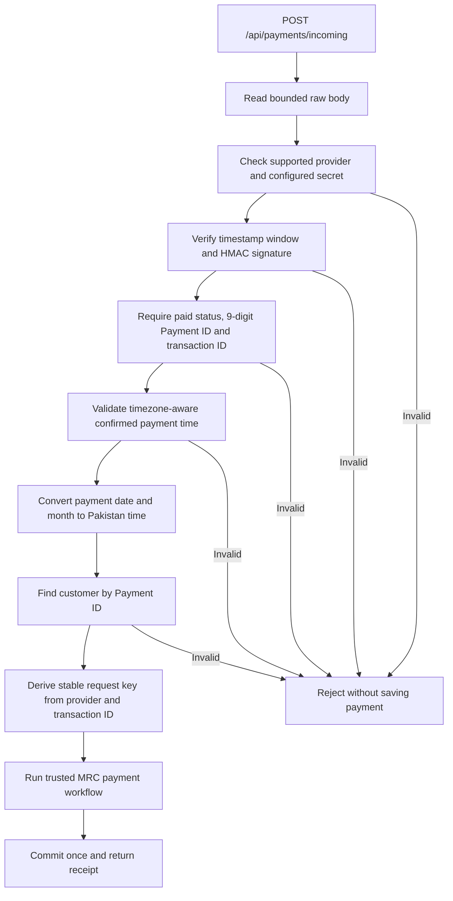


## 33. Process atlas — Inventory issue and return

System/network issues do not bill customers. Returns cover the entire saved issue quantity. Request locks and record locks prevent retry deductions and concurrent overselling.


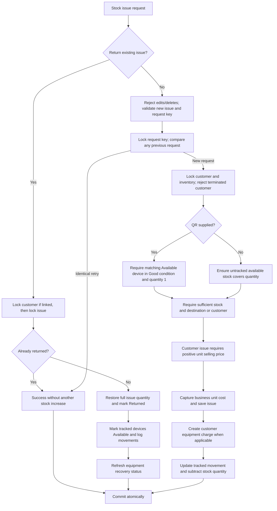


## 34. Process atlas — QR registration, condition and stocktake

Stocktake reports differences without automatically adjusting inventory quantities. Damaged and under-repair devices cannot be issued.


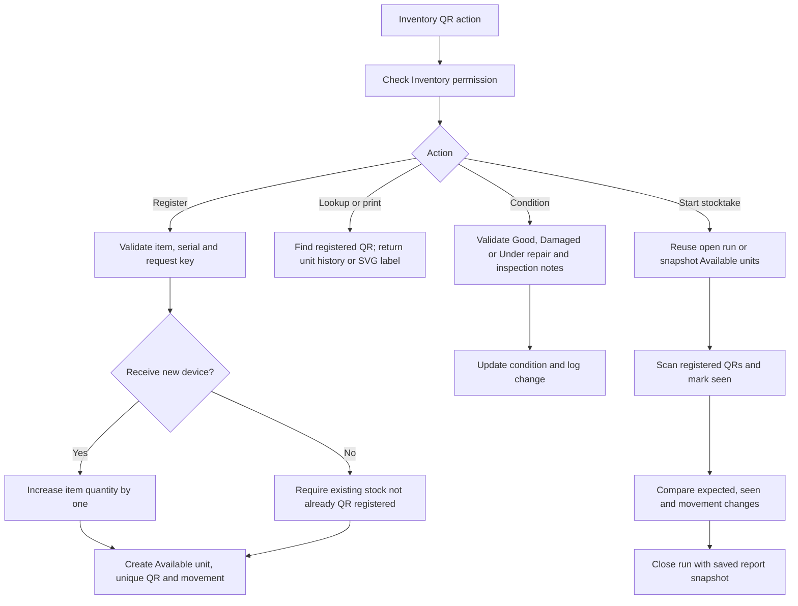


## 35. Process atlas — Tickets and turnaround targets

The TAT clock runs continuously. Reopening preserves the original clock. New assignments cannot use staff on leave. Jobs are archived legacy data consolidated into Tickets; the current interface excludes the Jobs schema.


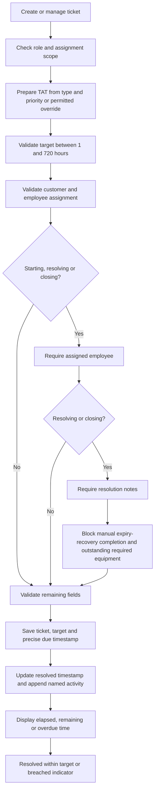


## 36. Process atlas — Termination and automatic expiry recovery

Termination itself never restores stock. Expiry recovery tickets can be generated even when no recoverable equipment is recorded. Automatic expiry checks do not implement router suspension.


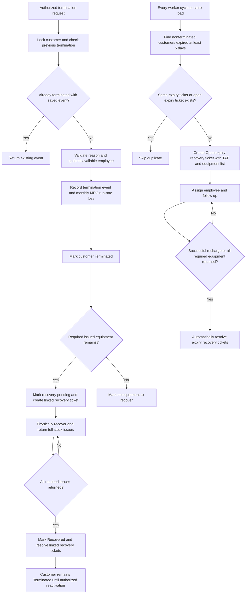


## 37. Process atlas — Customer portal


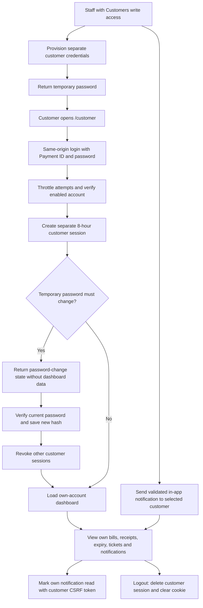


## 38. Process atlas — Documents, extra charges, expenses and administration

Documents accept PDF, JPEG, PNG and WebP: up to 5 files, 5 MB each and 20 MB combined per upload. Activation costs combine net issued inventory at captured business cost with allocated noncancelled expenses; monthly package costs are separate.


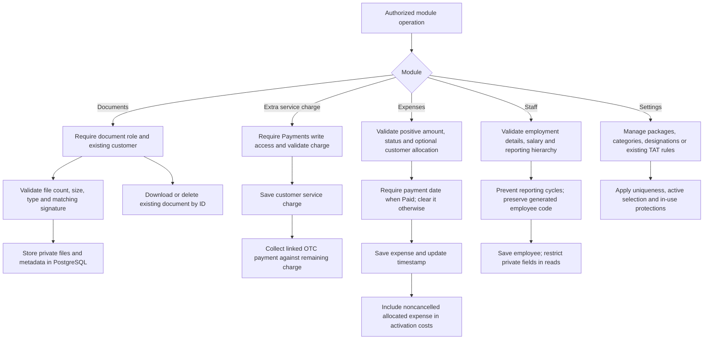


## 39. Process atlas — Assistant, reports and background processing

Financial reports distinguish invoice sales, receipt collections and paid expenses. Net cash is collections minus paid expenses. Dates and billing decisions use Asia/Karachi. CRM activation updates database state; live router/RADIUS provisioning is separate.


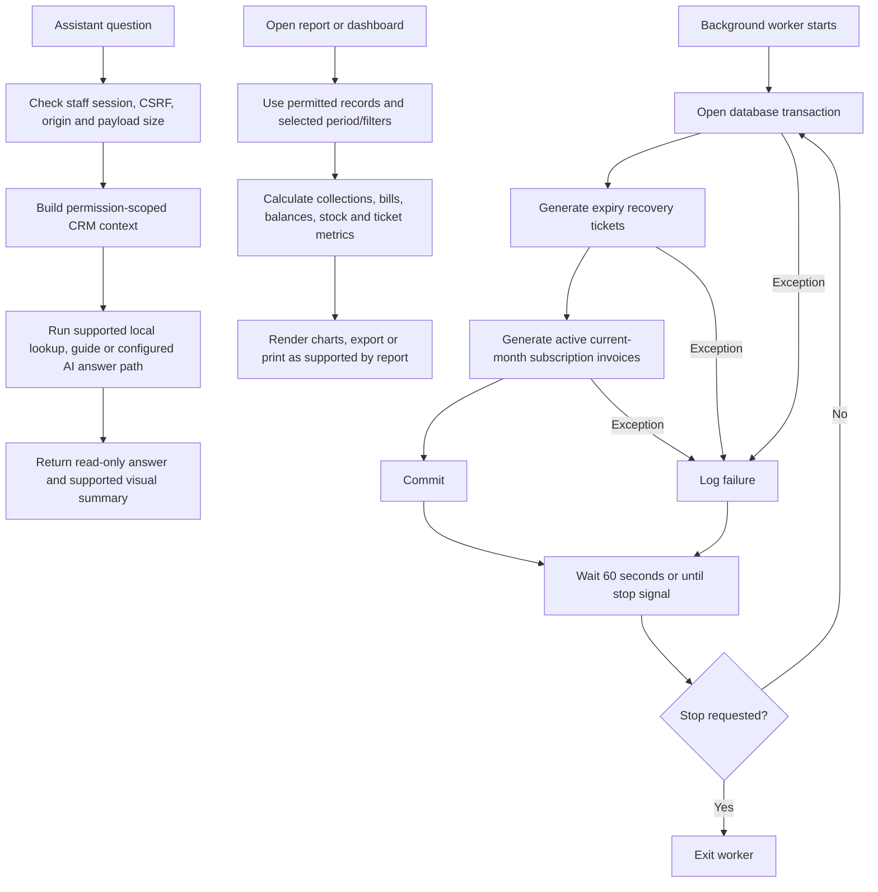


## 40. Process atlas — Password recovery: request and reset


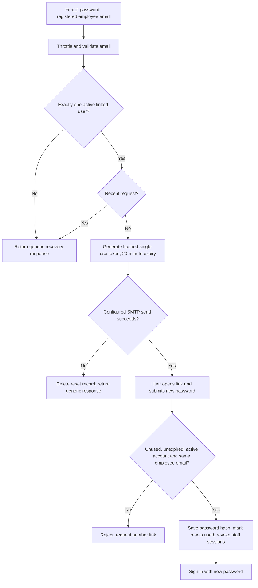


## 41. Process atlas — User creation, changes and deactivation


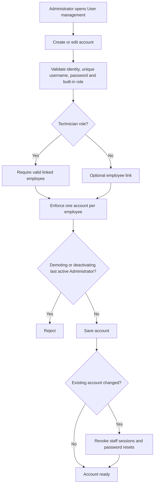


## 42. Process atlas — Package, category and designation maintenance


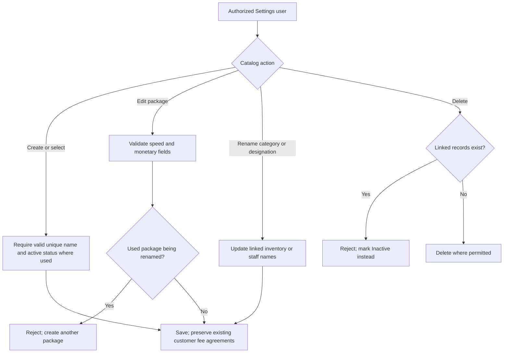


## 43. Process atlas — Employee registration and reporting hierarchy


```mermaid
flowchart TD
 A[Register or edit employee] --> B[Preserve existing generated code and omitted details]
 B --> C[Validate contact, dates, salary and employment fields]
 C --> D[Require active new designation selection]
 D --> E[Walk Reports to chain]
 E --> F{Missing manager, self-report or cycle?}
 F -->|Yes| G[Reject]
 F -->|No| H[Save employee and generated code]
 H --> I[Render hierarchy; restrict private staff fields]
 I --> J[Administrator separately creates or links login if needed]
```


## 44. Process atlas — Customer documents: upload, download and delete


```mermaid
flowchart TD
 A[Document request] --> B{Authenticated Administrator, Manager or Support?}
 B -->|No| C[Reject]
 B -->|Yes| D{Action}
 D -->|Upload| E[Require customer and files]
 E --> F[Validate count, size, extension and signature]
 F -->|Invalid| C
 F -->|Valid| G[Store private bytes and metadata in transaction]
 D -->|Download| H[Find document and return protected file]
 D -->|Delete| I[Delete existing document by ID]
 G & H & I --> J[Respond with result]
```


## 45. Process atlas — Extra services and installation collection


```mermaid
flowchart TD
 A[Finance user opens customer] --> B{Charge type}
 B -->|Installation| C[Use agreed installation amount and prior collections]
 B -->|Extra service| D[Save dated positive charge with unique request key]
 B -->|Customer equipment issue| E[Create Equipment charge from quantity and selling price]
 D & E --> F[Select charge row Record payment]
 C --> G[Record installation OTC payment]
 F --> H[Require matching customer, month and OTC category]
 G & H --> I{Amount within charge remaining?}
 I -->|No| J[Reject]
 I -->|Yes| K[Save linked payment and permanent receipt]
 K --> L[Update ledger and bill display; no MRC renewal]
```


## 46. Process atlas — Expense lifecycle and activation cost calculation


```mermaid
flowchart TD
 A[Add or edit expense] --> B[Validate positive amount, date, category and payee]
 B --> C{Status}
 C -->|Paid| D[Require payment date and method]
 C -->|Pending or Cancelled| E[Clear payment date]
 D & E --> F[Save optional customer allocation]
 F --> G[Expense reports: expense date vs paid date]
 F --> H[Customer activation costs]
 H --> I[Net issued inventory at captured cost]
 I --> J[Add linked Paid and Pending expenses; exclude Cancelled]
 J --> K[Show returned cost, historical estimates and unpriced warnings separately]
```


## 47. Process atlas — Customer editing, termination and reactivation branches


```mermaid
flowchart TD
 A[Authorized edit customer] --> B[Lock existing customer]
 B --> C{Terminated with required recovery pending?}
 C -->|Yes; attempting reactivation| D[Reject until all required stock returned]
 C -->|No or status retained| E[Preserve omitted fields and check paired saved coordinates]
 E --> F{Package unchanged?}
 F -->|Yes| G[Preserve agreed fee]
 F -->|No| H[Require active package and use selected price]
 G & H --> I[Installation charge cannot fall below collected installation receipts]
 I --> J{Changing to Terminated?}
 J -->|Yes| K[Run audited termination workflow]
 J -->|No| L[Save ordinary edit or recovered-account reactivation]
 K & L --> M[Commit with validated documents]
```


## 48. Process atlas — Reports, filters, CSV and print


```mermaid
flowchart TD
 A[Select report] --> B{Required Payments or Inventory read permission?}
 B -->|No| C[Hide or reject report]
 B -->|Yes| D[Set dates and search]
 D --> E{End date precedes start?}
 E -->|Yes| F[Show date error]
 E -->|No| G[Calculate role-permitted report rows]
 G --> H[Read report-specific interpretation note]
 H --> I{Output}
 I -->|On screen| J[View filtered table]
 I -->|Export CSV| K[Download spreadsheet rows]
 I -->|Print| L[Browser printer or Save as PDF]
```


## 49. Process atlas — Dashboard preferences and interpretation


```mermaid
flowchart TD
 A[Load scoped records] --> B{Administrator or Manager?}
 B -->|Yes| C[Company dashboard]
 B -->|No| D[Role dashboard with permitted summaries]
 C & D --> E[Select daily and monthly periods]
 E --> F[Read sales, cash, debt and operational figures]
 C --> G[Customize Dashboard: choose visible cards]
 G --> H[Save browser preference for login or Show all]
 H --> C
 E --> I[Choose layout and theme; retain browser preference]
```


## 50. Process atlas — Assistant: guide, lookups and optional AI


```mermaid
flowchart TD
 A[Signed-in staff opens CRM assistant] --> B[Validate origin, token and bounded question]
 B --> C[Throttle and build permission-scoped snapshot]
 C --> D{AI configured and AI mode selected?}
 D -->|No| E[Local guide, supported lookup and visual summary]
 D -->|Yes| F[Send scoped context to configured AI service]
 F --> G{Service succeeds?}
 G -->|No| H[Show error and suggest System guide]
 G -->|Yes| I[Return concise answer and supported visual]
 E & I --> J[Read-only result; no business mutation]
```


## 51. Process atlas — Customer portal provisioning and notifications


```mermaid
flowchart TD
 A[Staff with Customers write access] --> B{Action}
 B -->|Customer app access| C[Validate customer and generate temporary password]
 C --> D[Create or reset enabled portal account]
 D --> E[Require password change and revoke old portal sessions]
 E --> F[Return temporary credentials to staff]
 B -->|Send app notification| G[Validate customer, title and body limits]
 G --> H[Save unique in-app notification]
 I[Customer dashboard refresh] --> J[Deduplicate invoice, receipt, service and ticket updates]
 J --> K[Add near or past expiry reminder when applicable]
 H & K --> L[Customer reads own notifications and marks read]
```


## 52. Process atlas — Transaction rejection and retry outcomes


```mermaid
flowchart TD
 A[Incoming operation] --> B{Valid session, token and role?}
 B -->|No| C[401 or 403; no business save]
 B -->|Yes| D{Valid route and resource?}
 D -->|No| E[404 or validation error]
 D -->|Yes| F[Validate schema, references and business lifecycle]
 F -->|Invalid| G[400 or permission error; roll back if open]
 F -->|Valid| H[Execute protected transaction]
 H -->|Database failure| I[Roll back; 500 or 503 per endpoint]
 H -->|Success| J[Commit then acknowledge]
 J --> K{Client retries same idempotent request?}
 K -->|Identical| L[Reuse result without duplicate side effect]
 K -->|Conflicting details| G
 I --> M[Operator checks error; background worker logs and retries separately]
```


## 53. Scenario coverage and process cross-reference

The diagrams represent supported implementation branches and shared guards. They do not assert that unavailable integrations, hypothetical future workflows or every possible infrastructure failure have a business UI. For a rejected operation, use the exact message and the relevant rule rather than bypassing the workflow.


| Scenario group | Paths documented in feature reference and process atlas |
| --- | --- |
| Startup/authentication | First-owner setup, normal login, throttling, expired session, logout, known-password change, email reset and invalid/expired reset. |
| Users/staff/settings | Create/edit/deactivate, last admin, employee link, private fields, reporting cycle, active/inactive catalogs, used-record rename/delete protections, existing TAT rule. |
| Customers/documents | New/legacy customer, same/new package, expiry defaults/manual edits, deployment pin validation, atomic attachments, upload/download/delete, linked deletion, termination/reactivation. |
| Billing | Automatic eligible monthly bill, explicit issue, existing snapshot reuse, prior debt, services, uninvoiced historical gaps, Terminated new-bill rejection, print. |
| Payments | Manual/bridge, MRC/OTC, current/past/future month, full/partial/insufficient, already renewed, zero fee, Terminated, duplicate/conflicting keys, installation/service overpayment, immutable receipts. |
| Inventory | Catalog quantity edits, tracked/untracked issue, Customer/System/Network, insufficient stock, serial/QR registration, condition blocks, new/existing receipt modes, repeated/full return and stocktake. |
| Work/recovery | Unassigned/assigned, employee on leave, technician scope, status/notes validation, TAT edits/breach/reopen, termination recovery, five-day expiry, duplicate ticket suppression, recharge/return auto-resolution. |
| Customer access | Provision/reset, separate login, temporary password gate, own-account views, bills/receipts/tickets, notifications/read, password/session revocation and logout. |
| Review/operations | Role home, preferences, report date semantics, CSV/print, guide/AI/error, background retry, common HTTP errors, transaction rollback and graceful shutdown. |

## 54. Limitations and operating boundaries

- No live router/RADIUS provisioning or automatic network suspension is performed by CRM activation, expiry or termination alone.
- Native 1LINK/Easypaisa/JazzCash merchant connectivity requires separate onboarding/configuration. The signed bridge is an internal adapter contract, not an activated merchant account.
- The customer portal has no self-payment checkout or new-ticket submission form. In-app notices are not WhatsApp/SMS/background push delivery.
- No general invoice amendment/void, refund/credit-note or editable permanent receipt workflow is available. Do not delete history to simulate those operations.
- Full issue quantities are returned; partial return of an issue is unavailable. Physical returns do not automatically reverse charges.
- Monthly fees are full amounts without proration; historical uninvoiced months are not automatically billed as arrears. Historical payments do not automatically replay renewals.
- Roles are built-in, without a custom granular permission editor. Employee titles and hierarchy do not substitute for login permissions.
- TAT uses continuous calendar hours, not business hours or customer-wait pauses. Payroll/bank salary payments are not automatically disbursed.
- Dashboard/export data follows record permissions and report semantics. Current package, customer and termination ratios are not a complete historical churn/profit accounting system.
- The application binds to 127.0.0.1:3000 by default. External/mobile access and production hosting need explicit deployment configuration. CSV exports are not complete backups.

## 55. Implementation sources and document maintenance

This manual follows the current code where older README descriptions differ. Regenerate/review it after permissions, payment lifecycle, billing, stock recovery or integrations change. The PDF and standalone HTML are distribution copies; the Markdown and generator preserve the source.


| Area | Local source files |
| --- | --- |
| Routing, validation, lifecycle orchestration | ispcrm.py |
| Schema and migrations | crm_data.py, crm_jobs_migration.py, crm_employee_codes.py |
| Permissions, sessions and recovery | crm_auth.py, crm_password_recovery.py |
| Invoices, payments and receipts | crm_billing.py, crm_recharge.py, crm_receipts.py, crm_gateway.py |
| Account ledger and costs | crm_customer_ledger.py, crm_costs.py |
| Documents and portal | crm_documents.py, crm_customer_portal.py |
| Inventory and recovery | crm_inventory_qr.py, crm_termination.py |
| Staff reporting and TAT | crm_employee_hierarchy.py, crm_tat.py |
| Assistant | crm_assistant.py, crm_assistant_queries.py, crm_assistant_language.py, crm_assistant_visuals.py |
| Screens, dashboards and reports | web/index.html, web/app.js, web/customer-profile.js, web/reports.js, web/dashboard.js, web/business-dashboard.js, other web assets |
